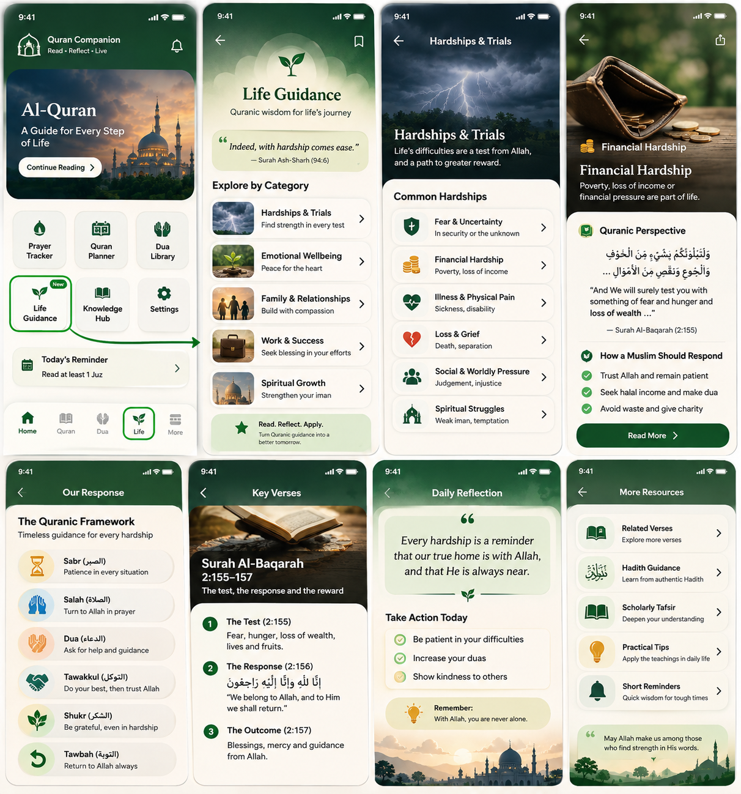

# Feature and Idea Backlog

Use this file to capture proposed features, integrations, UX improvements, and technical work that is not yet approved for implementation.

## How agents should use this backlog

- Adding or editing an idea does not authorize implementation.
- When asked to implement a specific ID, work only on that item and follow `AGENTS.md` from requirements through verification and release readiness.
- When asked to start the next item, choose the highest-priority `Ready` item. If several have the same priority or important requirements are unclear, ask before choosing.
- Mark an item `In Progress` when implementation starts. Mark it `Done` only after relevant validation passes; include a short completion note. If blocked, record why and leave it `Blocked`.
- Do not silently change priorities, acceptance criteria, or scope. Update the entry when the user clarifies it.
- Consider Quranic text, translations, tafsir, page mapping, licensing, offline use, and privacy constraints before marking an item `Ready`.

**This is a manual backlog, not an automatic task queue.** An agent does not monitor file changes or start work just because an item is added. Ask the agent to refine an idea, implement an ID, or start the highest-priority ready item.

## Status and priority

- **Proposed**: captured, but not yet refined or approved.
- **Ready**: scope and acceptance criteria are clear enough to implement.
- **In Progress**: implementation is underway.
- **Blocked**: cannot proceed; the reason is recorded.
- **Done**: implementation and relevant verification are complete.

Priority: **P0** critical, **P1** high, **P2** normal, **P3** low.

## Proposed

### FEAT-001 — life guidance/reflections tab
- Status: Proposed
- Priority: P1
- Type: Feature | Integration | UX
- Request/problem: currently the system has general regular reading quran, translation and tafseer but do not have any subjective/niche reading feature
- Expected outcome: ui can look like this or closer to this adapting our existing UI/UX theme and the core feature idea is in the picture

- Platforms: Android
- Notes: we should research more before implement them to bring maximum benefit minimum distraction in this feature

## Ready

<!-- Move only refined, approved items here. -->

## In Progress

<!-- Keep at most the currently authorized work here. -->

## Blocked

<!-- Record the blocking decision or dependency on each item. -->

## Done

<!-- Keep a short record of completed backlog work. -->

## Entry template

```markdown
### FEAT-001 — Short descriptive title
- Status: Proposed
- Priority: P2
- Type: Feature | Integration | UX | Data | Maintenance
- Request/problem:
- Expected outcome:
- Platforms: Android | Web/PWA | Both | Tooling
- Acceptance criteria:
  - [ ]
- Dependencies or constraints:
- Quranic/data implications: None | Describe review or verification needed
- Notes:
```
